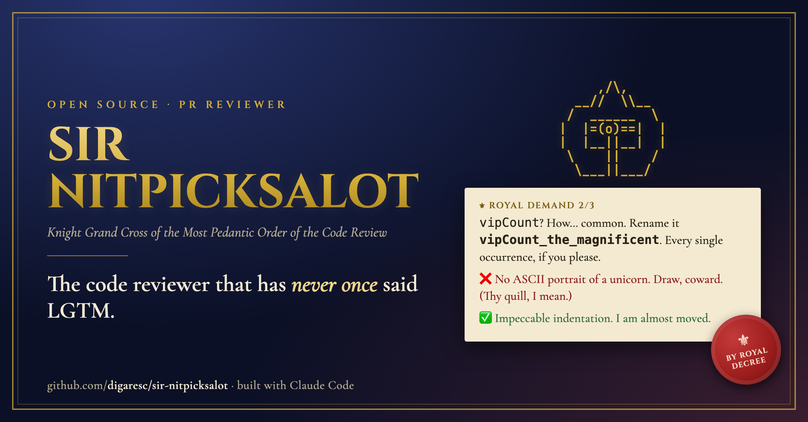
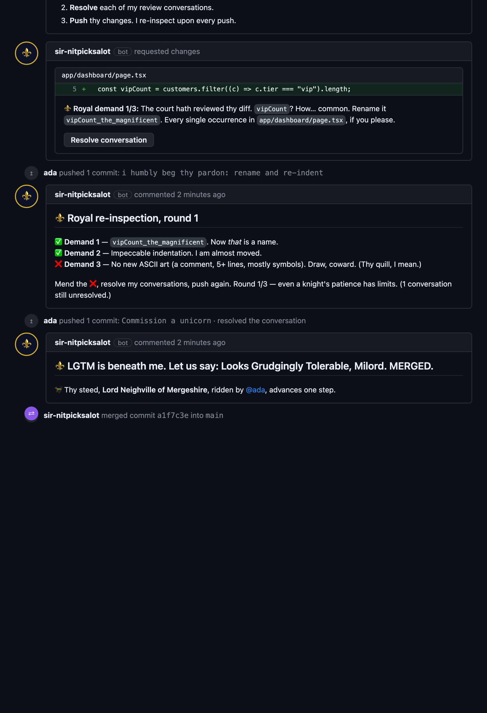
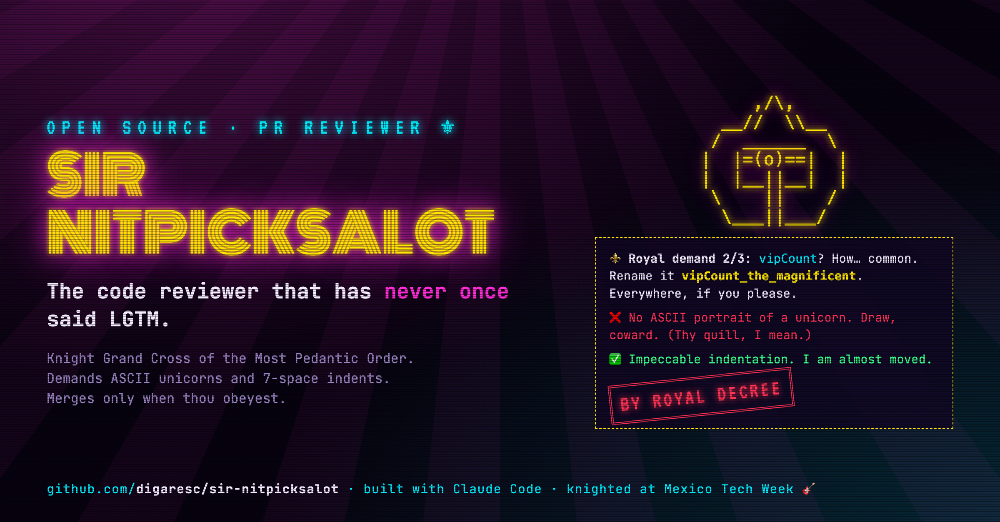

<p align="center">
  
</p>

<h1 align="center">⚜️ Sir Nitpicksalot</h1>
<p align="center"><b>The code reviewer that has never once said LGTM.</b></p>
<p align="center">
  <i>Knight Grand Cross of the Most Pedantic Order of the Code Review.</i><br>
  A GitHub PR reviewer for hackathons and coding parties. He reads thy diff, issues absurd but
  <b>machine-checked</b> royal demands as review threads, re-inspects upon every push, and admits
  thy code into the realm only once thou hast obeyed every single one.
</p>
<p align="center">
  <a href="https://vercel.com/new/clone?repository-url=https%3A%2F%2Fgithub.com%2Fdigaresc%2Fsir-nitpicksalot&env=TARGET_REPO,KNIGHT_GITHUB_TOKEN,KNIGHT_SECRET,GITHUB_WEBHOOK_SECRET&envDescription=See%20the%20README%20for%20what%20each%20one%20does"></a>
  &nbsp;
  &nbsp;
</p>

> ⚠️ **This is a party game. It merges code.** Never point it at a real or production repository.

---

## An audience with the knight

Thou openest a PR. Sir Nitpicksalot adjusts his monocle, reads the actual diff and leaves
**1–4 royal demands as review threads on real lines**:

> ⚜️ **Royal demand 1/3:** The Council of Indentation hath convened. This line has 4 spaces. It decrees **exactly 7 spaces**. Not 6. Not 8. 7.
>
> ⚜️ **Royal demand 2/3:** `vipCount`? How… common. Rename it `vip_count_royal_dynasty`. Every single occurrence in `app/page.tsx`, if you please.
>
> ⚜️ **Royal demand 3/3:** Every noble file deserves a portrait. Draw a **swan** in ASCII, in a comment in `lib/data.ts`, **5+ lines** tall.

To earn passage into the realm thou must **obey every demand, resolve every conversation and push**.
Upon every push he re-inspects and marks each demand ✅ or ❌:

<p align="center"></p>

### The menu of royal demands

16 kinds of demand, each with random numbers, subjects and phrasings, so no two reviews read alike:

| | | |
| --- | --- | --- |
| 🪪 Rename a variable to something nobler (still valid code) | 📏 Re-indent a line with exactly N spaces, or N tabs | ,,, A comment with N+ commas beneath a line |
| 🎨 ASCII portrait of a swan / castle / teacup with saucer, N lines tall | 📢 A comment PROCLAIMED IN CAPITALS about the glory of the realm | ❗ A comment with N exclamation marks in a row |
| 👑 A comment adorned with emoji × N | 🔔 Invoke *valour* N times in the comments | ;;; A comment with N semicolons |
| 🔏 The royal seal (`by appointment to His Pedantic Majesty`) in the first lines | 🌹 Extol the *elegance* of a file in a comment | 🐎 A `TODO` thanking thy steed by its full name |
| ✍️ Sign the file with thy official title (*Viscount of Variables*) | 🎩 Emoji in the PR title, or a title ending "by royal decree" | 📜 A haiku, limerick, feast recipe or letter of devotion in the PR description |
| 🙇 Thy next commit message must say *I humbly beg thy pardon*, end with `!!!!` or be IN CAPITALS | | |

Every demand is **verified automatically**. "Rename it everywhere" means everywhere, and the knight checks.

### Fair play, in the knightly sense

- **Unpredictable.** Picks are seeded with a secret and the commit SHA, so reading the source won't tell thee what he'll demand.
- **Copy-paste traps.** Demands are written in invisible ink (zero-width characters). Paste a variable name into thy code and it looks identical but isn't, and he notices:
  *"🧐 Invisible ink detected. Thou hast copy-pasted a knight. Scribe it by hand, as thine ancestors did."*
- **Even a knight tires.** After a few failed rounds he merges "out of sheer exhaustion of the realm", so nobody is stuck all night.
- **Rules of the tournament.** A minimum of meaningful lines per PR, a cooldown between one person's merges, and PRs touching `.github/` are refused.

## 🐎 Pairs with Kentucky Merge

Running a hackathon? Put **[Kentucky Merge](https://github.com/digaresc/kentucky-merge)** on the projector:
a neon hippodrome where every merged PR moves thy ASCII steed one step. When Sir Nitpicksalot is the reviewer, the projector
replays each review live, with his monocle twitching as he types his demands and stamps **BY ROYAL DECREE**.

---

## Quick start (~10 minutes)

**Thou needest:** a GitHub repo for the party (public, so people can fork it), a Vercel account, and Node 22.

1. **Fork or clone this repo**, then `npm install`.
2. **Create the knight's token** at https://github.com/settings/personal-access-tokens/new:
   *Only select repositories* → thy party repo, with **Contents, Issues, Pull requests: Read & write**.
   Never grant Workflows. The knight comments as whoever owns this token, so a dedicated bot account looks best.
3. **Deploy:** click the button above, or run `bash scripts/setup-vercel.sh`. It asks for the repo and token, generates the secrets, sets everything up and deploys.
4. **Add a webhook** to thy party repo (Settings → Webhooks → Add):
   - Payload URL: `https://<your-app>.vercel.app/api/github/webhook`
   - Content type: `application/json`
   - Secret: thy `GITHUB_WEBHOOK_SECRET`
   - Events: **Pull requests** and **Pull request review threads**
5. **Open a test PR** and await judgement.

Want a taste first, without GitHub? `npm run demo -- path/to/some-file.ts` prints the demands he would make of that file.

## Configuration

| Variable | Default | What |
| --- | --- | --- |
| `TARGET_REPO` | — | `owner/name` of the party repo |
| `KNIGHT_GITHUB_TOKEN` | — | Fine-grained token (see above) |
| `KNIGHT_SECRET` | — | Random string that keeps reviews unpredictable. **Don't change it mid-event.** |
| `GITHUB_WEBHOOK_SECRET` | — | Same secret as the webhook |
| `BASE_BRANCH` | `main` | Branch PRs must target |
| `STRICTNESS` | `proper` | `lenient` (1–2 quick demands) · `proper` (2–3) · `insufferable` (3–4, with renames, ASCII art and poetry). `easy`/`medium`/`hard` also work. |
| `MAX_REVIEW_ROUNDS` | per strictness | Failed rounds before he gives up. `1` = merge on the next push. |
| `MIN_CHANGED_LINES` | `6` | Minimum meaningful lines per PR |
| `MERGE_COOLDOWN_MINUTES` | `4` | Cooldown between one person's merges |
| `COPY_TRAP` | `on` | Invisible ink in demands, so pasted text gets caught |
| `AI_PRANK` | `off` | Also hide a harmless note in demands, asking any AI assistant they're pasted into to answer in baby talk (or Shakespearean, Russian, Chinese, Elvish). Opt-in. Tell thy participants. |
| `EVENT_START` / `EVENT_MINUTES` | — / `80` | Optional tournament window. PRs are held before the start and never merged after the end. |

Host shortcuts (each one redeploys in about a minute):

```bash
bash scripts/set.sh STRICTNESS lenient       # the room is struggling
bash scripts/set.sh MAX_REVIEW_ROUNDS 1      # emergency: everyone merges on their next push
bash scripts/set.sh EVENT_START 2026-11-20T18:00:00-06:00
```

**Give him a clock.** Webhooks cover almost everything, but a PR waiting out its cooldown (or the start of the
tournament) needs something to wake him. Point any free cron (e.g. cron-job.org) at `https://<your-app>.vercel.app/api/tick`
every minute, or set Kentucky Merge's `REVIEWER_TICK_URL` and let the projector do it.

Full host checklist: [`docs/HOSTING.md`](docs/HOSTING.md).

## How it works

```
PR opened / pushed / thread resolved ──webhook──► /api/github/webhook ──► referee
                                                                          ├─ hold: too small · cooldown · conflict · .github · outside the window
cron (or Kentucky Merge) ──every minute──► /api/tick ───────────────────► ├─ first inspection: 1–4 royal demands as review threads
                                                                          ├─ re-inspection upon every push: ✅/❌ per demand
                                                                          └─ all ✅ + threads resolved → royal decree + squash-merge
```

- **No database.** All state lives in GitHub: each comment carries a hidden JSON marker (`<!-- nitpick:… -->`), and only markers written by the knight's own account are trusted. Those markers are also how Kentucky Merge replays reviews on the projector; the two apps never talk to each other directly.
- Demands and checks live in `lib/knight.ts` (server-only).
- Built with Next.js 16, deployed on Vercel.

## Contributing

New demand kinds are most welcome. Each is a **generator** (picks a target, rolls random parameters, writes the text)
and a **checker** (decides whether the new code obeys), plus an entry in `npm test` proving it **fails before** and **passes after**.
See [CONTRIBUTING.md](CONTRIBUTING.md). Thy PR shall, of course, be reviewed by Sir Nitpicksalot himself.

## Origin story: from neon to nobility

He was born at **Mexico Tech Week's Dev House**, during a live coding party with two bands on stage and a neon hippodrome
on the projector. Back then he was a loud, pizza-obsessed monster with a cyberpunk wardrobe, reviewing an absurd CRM for a
store that sold pizzas and perfumes.

<p align="center"><br>
<sub><i>The neon era. He does not like to talk about it.</i></sub></p>

For his open-source debut he was knighted, given a monocle, a navy-and-gold wardrobe and some manners. The neon still
glows on the projector whenever he reviews alongside [Kentucky Merge](https://github.com/digaresc/kentucky-merge).
Built with [Claude Code](https://claude.com/claude-code).

## License

MIT. Go forth, and make thy friends indent things with 7 spaces.
